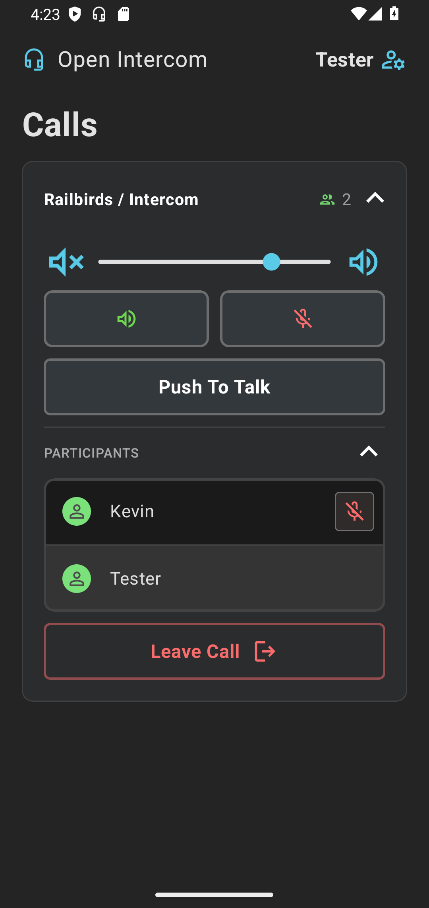

# Open Intercom for Android

A native Android client for joining calls on an
[Eyevinn Open Intercom](https://github.com/Eyevinn/intercom-frontend) server.
It does what the web client's guest view does — sit on a line, listen, talk —
and none of the production/line management.

Runs on Android 10 (API 29) and newer.



## Using it

1. In the web client, share the call (**Share** → keep *Restrict recipients to
   this call* ticked) and copy the link. It looks like
   `https://intercom.example.com/calls?lines=1:2&guest=1`.
2. Open the app, tap **Open settings**, and enter your name and that link.
3. If the server sits behind HTTP Basic authentication, enter that username and
   password under **Server sign-in**.
4. Save, then **Join Call**. With *Join the call when the app opens* on (the
   default) the app joins by itself from then on.

In a call you get the same controls as the web client: volume, speaker mute,
microphone mute, hold-to-talk, the participant list (with remote mute), and
Leave Call. The call keeps running with the screen off or the app in the
background (there is an ongoing notification with a Leave action); swiping the
app away ends it.

A link with several lines (`lines=1:2,1:3`) joins all of them. On a program
("audio feed") line, `:l` / `:p` after the line id selects listener / program
user as in the web client; without it the app joins as a listener.

## Building

Open the folder in Android Studio and run the `app` configuration, or from a
terminal:

```bash
./gradlew :app:assembleDebug
```

The command-line build needs a JDK 17+ in `JAVA_HOME` (Android Studio's bundled
one at `<Android Studio>/jbr` works) and the Android SDK location in
`local.properties` (`sdk.dir=...`), which Android Studio writes for you.

Library versions in `gradle/libs.versions.toml` are the newest that compile
against Android SDK 36.

### Release APK for other phones

The release build is shrunk with R8 and carries only the ARM native libraries
(about 20 MB, against 70 MB for a debug build). It therefore installs on phones
but not on x86 emulators; use the debug build there.

It has to be signed with your own key. Create a keystore once (Android Studio:
**Build → Generate Signed App Bundle or APK → APK → Create new…**) and keep the
file and its passwords safe: an installed app only accepts updates signed with
the same key. Then either keep using that wizard, picking the **release**
variant, or copy `keystore.properties.example` to `keystore.properties`, fill
it in, and run:

```bash
./gradlew :app:assembleRelease
```

The APK lands in `app/build/outputs/apk/release/`. Without
`keystore.properties` that command still builds, but the result is
`app-release-unsigned.apk`, which Android will not install.

Raise `versionCode` in `app/build.gradle.kts` for every build you hand out;
Android refuses to update to a build whose number is not higher.

## How it works

| | |
|---|---|
| `data/` | Settings (the Basic auth password is encrypted with an Android Keystore key) and call-link parsing. |
| `net/IntercomApi.kt` | The handful of intercom-manager REST calls a guest needs. The API base URL comes from the frontend's `/env.js`, falling back to the link's own host; it can be overridden under *Advanced*. |
| `call/LineCall.kt` | One joined line: session offer/answer, the WebRTC peer connection and data channel, heartbeat, participant long-poll, and automatic rejoin when the connection drops. |
| `call/MicrophoneGate.kt` | Silences capture the instant every line is muted, independent of WebRTC's slower track state. |
| `call/AudioRouter.kt` | Voice-call audio mode and output choice: Bluetooth headset, else wired headset, else loudspeaker. |
| `call/CallService.kt` | Foreground service that keeps the call alive in the background. |
| `ui/` | Jetpack Compose screens styled after the web client. |

WebRTC comes from [`stream-webrtc-android`](https://github.com/GetStream/webrtc-android),
a maintained build of Google's library.

## Credits

Icons and the connect/disconnect sounds are taken from
[Eyevinn/intercom-frontend](https://github.com/Eyevinn/intercom-frontend)
(MIT License, © Eyevinn Technology); the icons are Google Material Symbols
(Apache License 2.0).
